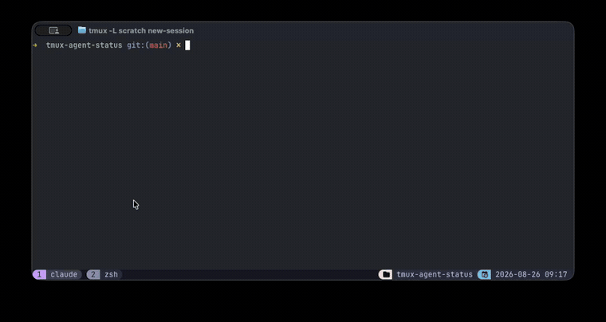

# tmux-agent-status

**Know which AI coding agent is waiting on you in tmux, and jump straight to it.**

A tmux plugin for running several coding agents at once: Claude Code, Codex,
Gemini CLI, Kimi Code, OpenCode, Hermes. It shows which pane is working, which
one needs your permission or an answer, and which one just finished, across
every session and window. You keep your own tmux setup; there's no wrapper,
daemon or dashboard to live in.



```
→1 ! waiting  5m | api:2.1       [1/2] | web (claude) · permission: Bash
 2 … working  1s | api:1.1       [2/2] | server (kimi)
 3 ✓ done     2m | billing:1.1         | agent (opencode)
 4 · idle     1h | notes:1.1           | nvim (claude-personal)
 5 ? unknown   - | scratch:1.1         | zsh (aider)
```

## Why hooks, not screen scraping

Status comes from each agent's own lifecycle hooks, so nothing parses terminal
output with regexes that break on the next UI update. Hooks are installed for
you, additively, for every supported agent found on your machine.

## Supported agents

| Agent | Integration | Tested against the real CLI |
|---|---|---|
| [Claude Code](https://github.com/anthropics/claude-code), including `CLAUDE_CONFIG_DIR` profiles | [hooks](https://code.claude.com/docs/en/hooks) | yes |
| [Kimi Code](https://moonshotai.github.io/kimi-code/) | hooks in `config.toml` | yes |
| [OpenCode](https://github.com/sst/opencode) 2 | TUI plugin | yes, except permission prompts |
| [Hermes](https://github.com/nousresearch/hermes-agent) | [shell hooks](https://hermes-agent.nousresearch.com/docs/user-guide/features/hooks) | yes |
| [Gemini CLI](https://github.com/google-gemini/gemini-cli) | [hooks](https://geminicli.com/docs/hooks/reference/) | install only: please report what you see |
| [Codex CLI](https://github.com/openai/codex) | [hooks](https://developers.openai.com/codex/hooks); trust them once with `/hooks` | install only: please report what you see |

Any other agent still appears in the picker as `? unknown`, found by its
process name. A new agent with Claude-style JSON hooks takes one small table:
see "Adding a new tool" below.

## What it does

- **Picker**: `prefix + j` opens a popup with every agent pane across *all*
  tmux sessions (via [`fzf`](https://github.com/junegunn/fzf)), needs-you first,
  with how long each status has held, why a pane is waiting, and a preview of
  the pane. Rows and preview update live while it's open, and rows keep their place until you reopen it. `tab` multi-selects and `ctrl-x` dismisses panes from the list.
- **Search**: type to filter by session, window, agent, status or waiting reason.
  In the grouped view a session stays only if one of its panes matches.
- **Two views**: `ctrl-s` in the picker switches between the flat needs-you-first
  list and one grouped by session, alphabetically, with a status rollup per session.
  Set the default with `view`.
- **Jump to the next one**: `prefix + J` goes to the pane that has waited
  longest, then panes you haven't looked at yet. Press again to cycle.
- **Seen tracking**: a finished pane stays `✓ done` until you look at it, then
  becomes a dimmed `· idle` and leaves the counter. So does one you left
  alone for a day (`idle_after`).
- **Status-line summary**: a persistent `!2 …1 ✓3` counter prepended to
  `status-right`, always visible.
- **Notifications**: a tmux message and (on macOS) a notification-center alert
  when a pane starts waiting or finishes, skipped for the pane you're looking
  at. Your terminal losing focus counts as not looking. Optional sound.
- **Containers and remote hosts**: agents that can't reach the tmux socket can
  report through a bridge file.

## Requirements

- [`fzf`](https://github.com/junegunn/fzf) (picker). Live refresh also needs
  `curl` and an fzf with `--id-nth` and socket `--listen` (tested on 0.74);
  otherwise the picker stays static until `ctrl-r`.
- Per adapter you use:
  - Claude Code, Gemini CLI, Codex: `jq`
  - OpenCode: `jq`, OpenCode 2 started at least once (it creates `cli.json`)
  - Kimi Code: nothing extra
  - Hermes: `python3` with `pyyaml`, or `yq`

Tested on macOS with its stock bash 3.2 and tmux 3.8. Seen tracking needs
`set -g focus-events on` to notice your terminal losing focus.

## Install

### Via TPM (recommended)

Add to `~/.tmux.conf`:

```tmux
set -g @plugin 'gudoshnikovn/tmux-agent-status'
```

Then `prefix + I` to install. This also detects which supported tools
are present on your machine and merges the required hooks into each
one's own config automatically (additive — it won't touch any hooks
you already have configured).

### Manual

```sh
git clone https://github.com/gudoshnikovn/tmux-agent-status.git ~/.tmux/plugins/tmux-agent-status
echo "run-shell ~/.tmux/plugins/tmux-agent-status/tmux/agent-status.tmux" >> ~/.tmux.conf
tmux source ~/.tmux.conf
```

## Configuration

Two ways to configure this, and they compose freely - use either or both:

### Config file

Copy [`config.example`](config.example) to
`~/.config/tmux-agent-status/config` (or point `$TMUX_AGENT_STATUS_CONFIG`
at a different path) and uncomment what you want to change:

```
pick_key = j
summary = on
notify_sound = off
```

A value here only takes effect if the same option isn't already set via
`set -g @agent_status_<key>` in `.tmux.conf` - an explicit `set -g`
always wins, no matter which one loads first.

### `.tmux.conf`

Set these *before* the plugin line:

```tmux
set -g @agent_status_pick_key 'j'          # prefix + j by default
set -g @agent_status_next_key 'J'          # prefix + J by default
set -g @agent_status_agents 'claude aider' # process names listed without hooks

set -g @agent_status_summary 'off'         # disable the status-right counter
set -g @agent_status_summary_icon_done '#[fg=colour245]✓'  # any text; #[...] styles work here, not in the config file
set -g @agent_status_notify 'off'          # disable the transient tmux popup
set -g @agent_status_notify_duration '3000'    # ms the tmux popup stays up
set -g @agent_status_notify_system 'off'   # disable the macOS notification
set -g @agent_status_notify_sound 'on'     # enable a sound on waiting/done (off by default)
set -g @agent_status_notify_sound_file '/System/Library/Sounds/Glass.aiff'
```

### Full option reference

| Config file key | `.tmux.conf` option | Default | Meaning |
|---|---|---|---|
| `pick_key` | `@agent_status_pick_key` | `j` | Key for `prefix + <key>` picker popup |
| `next_key` | `@agent_status_next_key` | `J` | Key for `prefix + <key>` jump to the next pane needing you |
| `icons` | `@agent_status_icons` | `minimal` | Icon set for the picker, counter and messages: `minimal` or `emoji` |
| `view` | `@agent_status_view` | `status` | Picker view on open: `status` or `session` |
| `popup_width` | `@agent_status_popup_width` | `100%` | Picker popup width |
| `popup_height` | `@agent_status_popup_height` | `100%` | Picker popup height |
| `preview_size` | `@agent_status_preview_size` | `75%` | Preview's share of the popup height |
| `idle_after` | `@agent_status_idle_after` | `1440` | Minutes until an unvisited `done` pane goes `idle`; `0` to never |
| `agents` | `@agent_status_agents` | common agent names | Space-separated process names shown as `? unknown` when they haven't reported |
| `summary` | `@agent_status_summary` | `on` | Status-right `!2 …1 ✓3` counter |
| `summary_icon_waiting` | `@agent_status_summary_icon_waiting` | from `icons` | Counter prefix for waiting panes |
| `summary_icon_working` | `@agent_status_summary_icon_working` | from `icons` | Counter prefix for working panes |
| `summary_icon_done` | `@agent_status_summary_icon_done` | from `icons` | Counter prefix for done panes |
| `notify` | `@agent_status_notify` | `on` | Transient tmux popup on waiting/done |
| `notify_duration` | `@agent_status_notify_duration` | `3000` | ms the tmux popup stays up |
| `notify_system` | `@agent_status_notify_system` | `on` if `osascript` exists | macOS notification-center alert |
| `notify_sound` | `@agent_status_notify_sound` | `off` | Sound on waiting/done |
| `notify_sound_file` | `@agent_status_notify_sound_file` | `/System/Library/Sounds/Glass.aiff` | Sound file to play |
| `transport` | `@agent_status_transport` | `direct` | `file` to relay through a bridge file instead of calling tmux directly — see below |
| `bridge_file` | `@agent_status_bridge_file` | — | Path to the bridge file when `transport = file` |

## Agent running in a container/VM/remote host

Agent running inside a devcontainer, plain Docker, WSL2 (a different
distro than tmux), or over SSH to a remote host can't reach the tmux
socket directly — direct `tmux` calls only work when the hook runs in
the same OS kernel the tmux server is in. There's an opt-in `file`
transport for this: the hook writes status transitions to a shared
bridge file instead of calling `tmux`, and a small relay running on
the host replays them into the real tmux server.

See **[docs/remote-agents.md](docs/remote-agents.md)** for how it
works, the `transport`/`bridge_file` options, and ready-to-use launch
patterns for devcontainer CLI, plain Docker, SSH, and WSL2.

## How it works

Every supported tool's hooks call `core/agent-status.sh <status>
--tool <name>`, which writes per-pane tmux user options
(`@agent_status`, `@agent_status_tool`) using `$TMUX_PANE`.
`core/agent-picker.sh` / `core/agent-status-summary.sh` scan
`@agent_status` across all panes/sessions for the popup picker and the
status-line counter.

Each adapter's `hooks.map` lists which event sets which status. The full
reasoning for Claude Code's is in CLAUDE.md, since it was non-obvious and
previously got it wrong twice.

## Crash / interrupt recovery

If a tool's process dies or gets interrupted without firing a
"turn ended" hook, its pane could otherwise stay stuck on a stale
`working`/`waiting` status forever. Every adapter gets a shared
safety net for this: `core/agent-status-summary.sh` re-checks, on every
status-line recompute, whether each pane's foreground process
(`#{pane_current_command}`) still matches that tool's
`adapters/<tool>/process-pattern`; if it doesn't (the tool exited and
the shell took back over, or crashed), the status is cleared. This is
**not** a timeout — a pane that's genuinely still running a long tool
call keeps its `working` status for as long as that takes, since the
sweep only looks at whether the process is still there, never at how
long it's been there.

## Adding a new tool

Add a directory `adapters/<tool>/` with:

- `detect.sh` — no args, exit 0 if the tool looks usable on this machine (e.g.
  a binary on `PATH`), exit 1 otherwise.
- `install-hooks.sh` — idempotent, additive: registers hooks in that tool's own
  config, each one invoking `core/agent-status.sh <working|waiting|done|clear>
  --tool <tool>`, and removes them on `--uninstall`.
- `process-pattern` — a single-line regex matched against
  `#{pane_current_command}`, used only by the crash/liveness sweep above.

If the tool uses Claude-style JSON hooks, `install-hooks.sh` is a one-line call
to `core/install-json-hooks.sh` plus a `hooks.map` table (see `adapters/gemini/`).

`tmux/agent-status.tmux` picks up any `adapters/*/` directory automatically on
every `tmux source-file` — no core changes needed. Run the tests with
`for t in tests/*.sh; do "$t"; done`.

## Known limitations

- **Stale "waiting" while a tool runs after approval (Claude Code).**
  Once you approve a permission prompt, the pane keeps showing
  `waiting` until the tool finishes — for a slow tool (a web fetch, a
  long shell command), it can look like it's still waiting on you
  when it's actually running. This is a gap in Claude Code's hook API
  itself: no hook fires between a permission decision resolving and
  the tool starting to execute, only `PreToolUse` (before the
  permission check) and `PostToolUse` (after the tool finishes). No
  workaround is possible until Claude Code adds a hook for that
  transition — tracked at
  [anthropics/claude-code#77700](https://github.com/anthropics/claude-code/issues/77700),
  see CLAUDE.md for the full writeup. Kimi Code and OpenCode don't have this
  gap.
- **Interrupted turns (Claude Code, Gemini CLI).** Claude Code has no interrupt
  hook, so an interrupted pane reads `working` for up to ~60s until
  `idle_prompt`. Gemini CLI documents no interrupt or API-error event, and no
  equivalent fallback.

## Uninstall

Remove the `@plugin` line, then remove the hooks from each agent's config:

```sh
cd ~/.tmux/plugins/tmux-agent-status
for tool in claude-code gemini codex kimi opencode; do adapters/$tool/install-hooks.sh --uninstall; done
adapters/hermes/uninstall-hooks.sh
```

The first edit of each config leaves a `<file>.bak.tmux-agent-status` copy next
to it.
